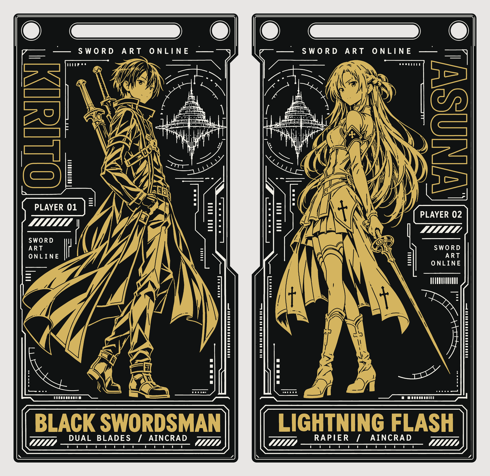
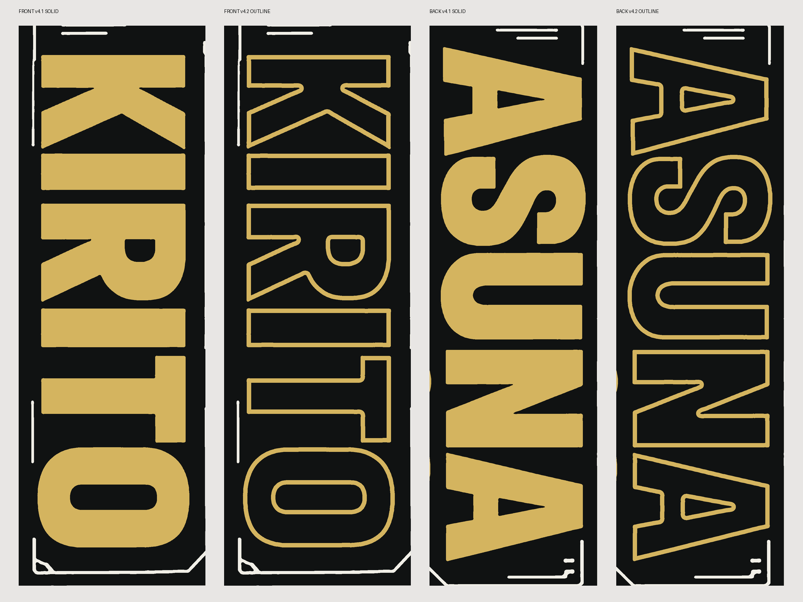

想给喜欢的角色做一张能拿在手里的通行证：正面是桐人，背面是亚丝娜，两面都保留全身侧站。最后整理成约 49.87 × 99.87 mm 的双面艺术 PCB，用沉金、哑黑阻焊和普通白色丝印形成画面。

**截至 2026-11-10，5 片打样已下单，实物尚未收到。** 下面展示的是工程预览；复刻文件已经检查，但成品的细线、颜色和反光还需要到货验证。



板框、孔槽与制作思路来自 [observer0703 的红莉栖沉金 PCB](https://github.com/observer0703/-kurisu-enig-pcb/releases/tag/v1.0.0)。感谢原作者分享这条制作路线。本版新增了刀剑神域图案、图层工程化处理和姓名描边，完整来源写在 [CREDITS](https://github.com/adenzhou1350/enig-pcb-art/blob/main/CREDITS.md)。

## 把画面拆成三种材料

AI 辅助图稿能帮助确定姿态和构图，上板还需要重新整理图层。金色图形要同时落在铜层和阻焊开窗层，露出的铜再做沉金；白色细节放到丝印层，其余区域由黑色阻焊形成背景。这次没有使用彩色丝印。

发丝、衣褶、剑和装饰文字分别检查路径闭合、图层对应以及到板边和孔槽的距离。两面 SVG 按正常阅读方向导出，锁定的原生图层已处理底面坐标，复刻时不用再手工镜像。

## 减少金色面积，保留人物

试算时，把竖排的 KIRITO 和 ASUNA 从实心金色改成约 0.25 mm 的描边，底部称号仍然保留实金。人物、衣褶和武器保持原来的细节。本地计算的双面开窗面积由约 21.62 cm² 降到 19.28 cm²；这是设计筛查数值，不是厂家测得的面积。



最终选用 2 层 FR-4、1.6 mm 板厚、1 oz 铜厚、哑黑阻焊、白色普通字符和沉金 1U。本次用券下单 5 片，含运费实付 0 元。这只是这次账户、券和参数组合的结果；其他人仍需在报价页核对资格和最终金额，不能把它当成固定价格。

## 复刻包里有什么

[SAO v1.0.0 资料包](https://github.com/adenzhou1350/enig-pcb-art/releases/tag/v1.0.0) 保留本版新增的 SVG、二值图层、锁定原生路径、构建脚本与中文打板指南。安装 Python 3.10 或更新版本，解压该版本资料包后运行：

```powershell
python scripts/build.py --download-upstream
```

脚本获取原作者的固定附件，校验 SHA256 后在本地组装，输出 `dist/Kirito-Asuna-Fine-v4.2.epro2`，再导入嘉立创 EDA 专业版。上游尚未明确统一许可证，所以公开包不再分发完整继承工程。新增程序代码采用 MIT；上游设计和角色/IP不包含在该授权内，详见仓库的分项许可说明。

## 已经检查，以及还没确定的事

从公开下载包重新生成的工程，与下单版的 1194 个艺术填充、2865 个环及板框、孔槽几何一致。公开构建文件已实际导入 EDA，完成 141 项 DRC、0 问题，并核对两面预览。

这些结果说明文件结构和设计规则检查通过，不能代替厂家的工艺审查或实物验收。细小尖端会不会丢失、丝印是否糊在一起、金色在日常光线下怎样，都留到样板到手后再记录。到时会补上正反面实拍和细节对照，继续保留这版工程预览作为比较。

这版现收录在[黑金 PCB 作品集](https://github.com/adenzhou1350/enig-pcb-art)，同合集的 Mob 与夏油杰目前是工程预览。本文继续保留 SAO 的制作过程和本次打样记录。
